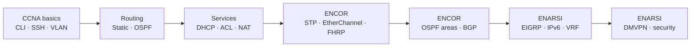

<div align="center">

# 🌐 Cisco Study Notes
### CCNA → CCNP ENCOR → CCNP ENARSI

Organized CLI notes with explanations, corrected commands and verification steps.


</div>

---

## 📚 Contents

| Level | Notes |
|-------|-------|
| 🟢 **CCNA** | [Device mgmt, switching, routing, services, IPv6](ccna/README.md) |
| 🔵 **CCNP ENCOR** | [Advanced switching, EIGRP/OSPF/BGP, FHRP, security, VPN, automation](ccnp-encor/README.md) |
| 🟣 **CCNP ENARSI** | [DHCP/IPv6, advanced EIGRP/OSPF/BGP, VRF, DMVPN, uRPF](ccnp-enarsi/README.md) |


## 🧪 Labs

| Lab | Description |
|-----|-------------|
| [Campus Lab: MikroTik + Cisco IOSv (EVE-NG)](labs/ccna-mikrotik-campus-eve-ng/README.md) | 2 MikroTik + 2 IOSv routers and 6 switches: VLANs, ROAS, PAgP EtherChannel, STP, port security, DHCP, static routing. Includes a VTP extension |

## 🗺️ Suggested study path



## 🗂️ Repository layout

```
.
├── ccna/            5 topic files
├── ccnp-encor/      7 topic files
├── ccnp-enarsi/     7 topic files
└── raw-notes/       original unedited notes (Persian/English)
```

## 🧭 Conventions

- `!` starts a comment inside config blocks.
- Passwords, keys and community strings (`LabKey123`, `MyPass`, …) are lab placeholders – **never use them in production**.
- Commands target Cisco IOS / IOS-XE; syntax can vary a little by platform and version. Verify in a lab (GNS3, EVE-NG, CML, Packet Tracer) before relying on them.

## ✅ Corrections made to the original notes

- Typos fixed (`traunk`, `loopbak`, `transliteration`, `nex-hop`, `bpdugurd`, …).
- RSA keys ≥ 2048 bits, `transport input ssh`, `weekdays` in time-ranges.
- IPsec on GRE: the peer address is the tunnel **destination** (underlay), not the overlay IP.
- `ip arp inspection filter … static`: only the ACL is used (no snooping fallback).
- Iran time zone is UTC+3:30 (`clock timezone IRST 3 30`).

## 📄 License

MIT – see [LICENSE](LICENSE).
