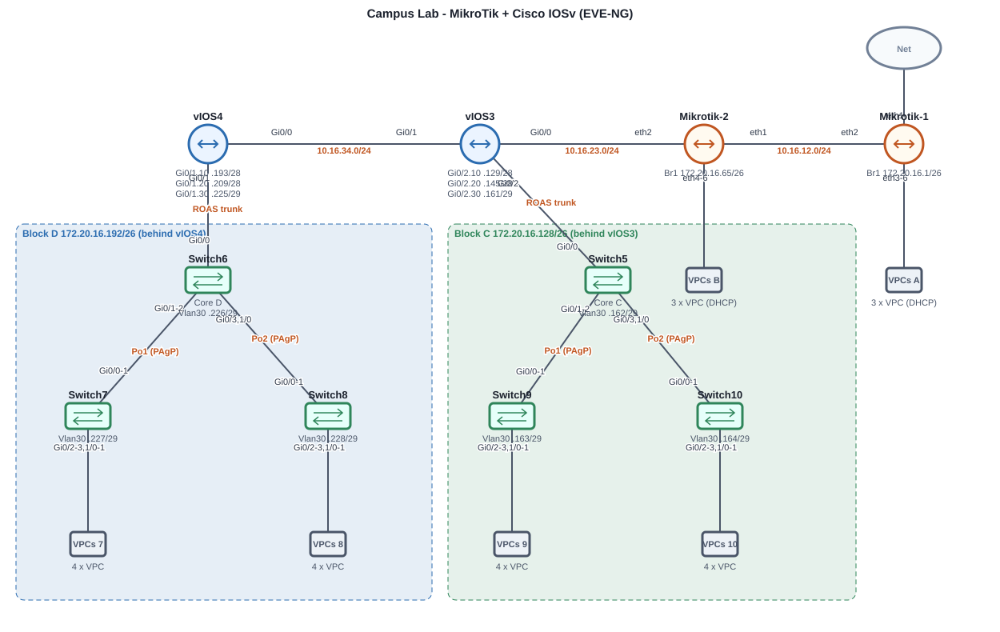
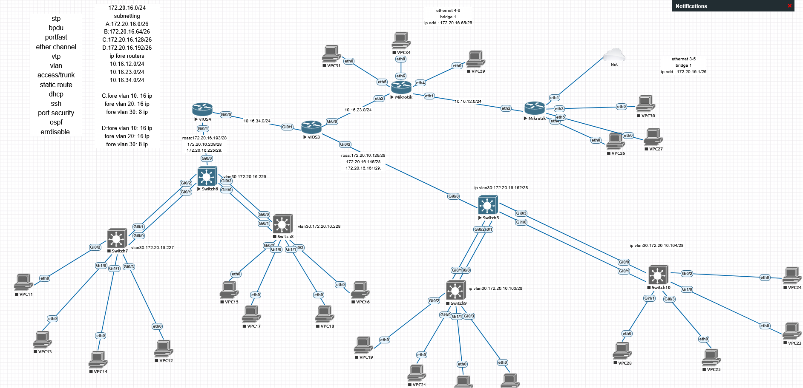
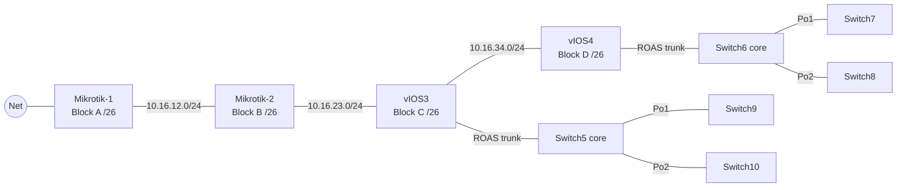

<div align="center">

# 🏢 Campus Lab: MikroTik + Cisco IOSv in EVE-NG

**VLANs · Router-on-a-Stick · PAgP EtherChannel · STP · Port Security · DHCP · SSH · Static Routing**


</div>

A small campus network with **two MikroTik (RouterOS 7)** routers, **two Cisco IOSv** routers and **six IOSvL2 switches**. One `/24` is split into four `/26` blocks, and every block has its own gateway and DHCP service.

| | |
|---|---|
| **Difficulty** | CCNA |
| **Time** | 60 – 90 minutes |
| **Images** | IOSv, IOSvL2, MikroTik CHR (RouterOS 7), VPCS |
| **Lab credentials** | `admin` / `LabPass123` (placeholder, lab only) |

## 🗺️ Topology



<details>
<summary>Original EVE-NG canvas (click to expand)</summary>



</details>

## 🎯 What you will learn

- Split a `/24` into four `/26` subnets and carve `/28` and `/29` subnets out of two of them.
- Build VLANs 10, 20, 30 with access and 802.1Q trunk ports.
- Route between VLANs with **router-on-a-stick** on Cisco IOSv.
- Bundle links with **PAgP EtherChannel** and keep the topology loop-free with **STP**.
- Protect access ports with **PortFast, BPDU Guard, port security** and **errdisable recovery**.
- Run **DHCP** on both Cisco and MikroTik, and manage devices with **SSH**.
- Tie four routers together with **static routes**.

## 🔀 How traffic flows



## 📐 Addressing plan

`172.20.16.0/24` is split into four blocks:

| Block | Network | Gateway device | Hosts |
|:-----:|---------|----------------|-------|
| **A** | `172.20.16.0/26` | Mikrotik-1 (bridge1 `.1`) | DHCP `.2 – .62` |
| **B** | `172.20.16.64/26` | Mikrotik-2 (bridge1 `.65`) | DHCP `.66 – .126` |
| **C** | `172.20.16.128/26` | vIOS3 (router-on-a-stick) | VLANs 10, 20, 30 |
| **D** | `172.20.16.192/26` | vIOS4 (router-on-a-stick) | VLANs 10, 20, 30 |

**VLAN plan for blocks C and D**

| VLAN | Block C | Block D | Purpose |
|:----:|---------|---------|---------|
| 10 | `172.20.16.128/28` · gw `.129` | `172.20.16.192/28` · gw `.193` | users |
| 20 | `172.20.16.144/28` · gw `.145` | `172.20.16.208/28` · gw `.209` | users |
| 30 | `172.20.16.160/29` · gw `.161` | `172.20.16.224/29` · gw `.225` | switch management |

**Switch management IPs (VLAN 30):** Switch5 `.162` · Switch9 `.163` · Switch10 `.164` · Switch6 `.226` · Switch7 `.227` · Switch8 `.228`

**Router-to-router links**

| Link | Network | Addresses |
|------|---------|-----------|
| Mikrotik-1 ↔ Mikrotik-2 | `10.16.12.0/24` | `.1` / `.2` |
| Mikrotik-2 ↔ vIOS3 | `10.16.23.0/24` | `.1` / `.2` |
| vIOS3 ↔ vIOS4 | `10.16.34.0/24` | `.1` / `.2` |

## 🔌 Cabling

| Device A | Port | Device B | Port | Notes |
|----------|------|----------|------|-------|
| Net (cloud) | – | Mikrotik-1 | ether1 | WAN, DHCP client |
| Mikrotik-1 | ether2 | Mikrotik-2 | ether1 | 10.16.12.0/24 |
| Mikrotik-2 | ether2 | vIOS3 | Gi0/0 | 10.16.23.0/24 |
| vIOS3 | Gi0/1 | vIOS4 | Gi0/0 | 10.16.34.0/24 |
| vIOS3 | Gi0/2 | Switch5 | Gi0/0 | ROAS trunk |
| vIOS4 | Gi0/1 | Switch6 | Gi0/0 | ROAS trunk |
| Switch5 | Gi0/1, Gi0/2 | Switch9 | Gi0/0, Gi0/1 | Po1 (PAgP) |
| Switch5 | Gi0/3, Gi1/0 | Switch10 | Gi0/0, Gi0/1 | Po2 → Po1 on Switch10 |
| Switch6 | Gi0/1, Gi0/2 | Switch7 | Gi0/0, Gi0/1 | Po1 (PAgP) |
| Switch6 | Gi0/3, Gi1/0 | Switch8 | Gi0/0, Gi0/1 | Po2 (PAgP) |
| Mikrotik-1 | ether3 – ether5 | 3 × VPC | eth0 | block A hosts |
| Mikrotik-2 | ether4 – ether6 | 3 × VPC | eth0 | block B hosts |
| Switch7/8/9/10 | Gi0/2, Gi0/3, Gi1/0, Gi1/1 | 4 × VPC each | eth0 | access ports |

**Access-port VLANs**

| Switch | Gi0/2 | Gi0/3 | Gi1/0 | Gi1/1 |
|--------|:-----:|:-----:|:-----:|:-----:|
| Switch7 | 10 | 20 | 10 | 20 |
| Switch8 | 10 | 20 | 10 | 20 |
| Switch9 | 10 | 10 | 20 | 20 |
| Switch10 | 20 | 10 | 20 | 10 |

## 🛠️ Build it step by step

1. **Create the nodes** in EVE-NG and cable them as in the table above. Use the names from the topology.
2. **Switches first.** Paste `Switch5.cfg` … `Switch10.cfg`. This creates VLANs, trunks, EtherChannels and STP roots.
3. **Routers.** Paste `vIOS3.cfg` and `vIOS4.cfg`.
4. **MikroTik routers.** Paste `Mikrotik-1.rsc` and `Mikrotik-2.rsc` (or upload and run `/import file-name=…`).
5. **SSH keys.** On every Cisco device run once: `crypto key generate rsa modulus 2048`.
6. **VPCs.** On each VPC run `ip dhcp`.
7. **Save.** `write memory` on Cisco, `/system backup save` on MikroTik.
8. **Optional internet:** run [`Mikrotik-1-optional-internet.rsc`](configs/Mikrotik-1-optional-internet.rsc) on Mikrotik-1.

Cisco paste procedure:
```
enable
configure terminal
<paste the .cfg file>
end
write memory
```

| Device | Config file |
|--------|-------------|
| Mikrotik-1 | [`Mikrotik-1.rsc`](configs/Mikrotik-1.rsc) |
| Mikrotik-2 | [`Mikrotik-2.rsc`](configs/Mikrotik-2.rsc) |
| vIOS3 · vIOS4 | [`vIOS3.cfg`](configs/vIOS3.cfg) · [`vIOS4.cfg`](configs/vIOS4.cfg) |
| Core switches | [`Switch5.cfg`](configs/Switch5.cfg) · [`Switch6.cfg`](configs/Switch6.cfg) |
| Access switches | [`Switch7.cfg`](configs/Switch7.cfg) · [`Switch8.cfg`](configs/Switch8.cfg) · [`Switch9.cfg`](configs/Switch9.cfg) · [`Switch10.cfg`](configs/Switch10.cfg) |

## 📚 Concepts used (with the key commands)

**VLANs and trunks.** Each access port belongs to one VLAN. Links between switches and to the routers are 802.1Q trunks.
```
switchport mode access
switchport access vlan 10
switchport mode trunk
```

**Router-on-a-stick.** One physical router port carries all VLANs, one sub-interface per VLAN acts as the gateway.
```
interface GigabitEthernet0/2.10
 encapsulation dot1Q 10
 ip address 172.20.16.129 255.255.255.240
```

**PAgP EtherChannel.** Two physical links behave as one logical link (`Port-channel`). The core uses `auto`, the edge uses `desirable`, so the channel forms (`auto` + `auto` never does).
```
channel-group 1 mode desirable non-silent
```

**STP (PVST) with a fixed root.** The core switches get priority `24576` so they are always the root.
```
spanning-tree vlan 1,10,20,30 priority 24576
```

**PortFast + BPDU Guard.** Access ports skip STP listening/learning; if a switch is plugged in by mistake the port is shut down.
```
spanning-tree portfast edge
spanning-tree bpduguard enable
```

**Port security.** One sticky MAC per access port; with `restrict`, other MACs are dropped and logged.
```
switchport port-security
switchport port-security maximum 1
switchport port-security violation restrict
switchport port-security mac-address sticky
```

**errdisable recovery.** Ports shut down by BPDU Guard or port security come back automatically after 30 seconds.
```
errdisable recovery cause bpduguard
errdisable recovery cause psecure-violation
errdisable recovery interval 30
```

**DHCP.** vIOS3 and vIOS4 serve VLANs 10 and 20 (gateway addresses are excluded). The MikroTik routers serve their own LAN bridge.

**Static routing.** Every router has a default route and routes to the blocks behind its neighbors:

| Device | Routes |
|--------|--------|
| Mikrotik-1 | `.64/26`, `.128/26`, `.192/26`, `10.16.23.0/24`, `10.16.34.0/24` via `10.16.12.2` · default from WAN DHCP |
| Mikrotik-2 | default via `10.16.12.1` · `.128/26`, `.192/26`, `10.16.34.0/24` via `10.16.23.2` |
| vIOS3 | default via `10.16.23.1` · `172.20.16.192/26` via `10.16.34.2` |
| vIOS4 | default via `10.16.34.1` |

## ✅ Verification checklist

| Test | Command | Expected |
|------|---------|----------|
| VLANs exist | `show vlan brief` | VLANs 10, 20, 30 on every switch |
| Trunks up | `show interfaces trunk` | Po1/Po2 and the router uplink trunking |
| EtherChannel | `show etherchannel summary` | `Po1(SU)` with members `(P)` |
| STP root | `show spanning-tree vlan 10` | Switch5 / Switch6 say "This bridge is the root" |
| Port security | `show port-security` | max 1, violation `restrict` |
| DHCP (Cisco) | `show ip dhcp binding` | leases from VLAN 10 / 20 pools |
| DHCP (MikroTik) | `/ip dhcp-server lease print` | leases in block A / B |
| Routing | `show ip route` · `/ip route print` | routes to all four blocks |
| End-to-end | from a VPC: `ping 172.20.16.1`, `.65`, `.129`, `.193` | replies from all four gateways |
| Management | `ssh -l admin 172.20.16.162` | login works with the lab password |

## 🧰 Troubleshooting

| Symptom | Likely cause | Check / fix |
|---------|--------------|-------------|
| VPC gets no IP | VLAN missing on trunk, or router sub-interface down | `show interfaces trunk`, `show ip interface brief` |
| Port-channel stays `(I)` | both ends `auto` or mismatched members | one side `desirable`, same speed/duplex/VLANs |
| Port goes `err-disabled` | BPDU Guard or port security | `show errdisable recovery`; the port returns after 30 s |
| Can ping the gateway but not other blocks | missing static route | compare with the routing table above |
| Block A clients get addresses from other blocks | MikroTik pool/mask wrong | pool must be `172.20.16.2-62` with `/26` |
| SSH refused | no RSA key | `crypto key generate rsa modulus 2048` |
| `%CDP-4-DUPLEX_MISMATCH` | IOSv duplex negotiation quirk | set `duplex full` on both ends |

## 🧪 Challenges

1. Plug a switch into an access port and watch BPDU Guard shut the port down, then recover.
2. Connect a second VPC with another MAC to an access port and read `show port-security interface`.
3. Shut one member of a Port-channel and check that traffic keeps flowing.
4. Move the STP root to an edge switch, then fix it again with priorities.
5. Use **VTP** (core = server, edge switches = clients) instead of creating VLANs by hand. See [`extensions/vtp.md`](extensions/vtp.md).

## 🔧 Fixes compared with the original configs

| # | Device | Problem | Fix |
|---|--------|---------|-----|
| 1 | Switch5/9/10, vIOS4, Switch6/7 | VLAN 30 mask `/28` on some devices, `/29` on vIOS3 and in the design | all VLAN 30 interfaces use `/29` |
| 2 | Switch8 | no VLAN 30 SVI and no default gateway | added `172.20.16.228/29`, gateway `.225` |
| 3 | Mikrotik-1 | `bridge1` `/24` with pool `.2 – .254`: clients could receive addresses of other blocks | `/26`, pool `.2 – .62` |
| 4 | Mikrotik-1/2 | `10.16.12.1/26` on one side, `10.16.12.2/24` on the other | both `/24` |
| 5 | Mikrotik-1 | leftover OpenVPN server and a `ppp secret` without password | removed |
| 6 | Mikrotik-2 | DHCP client on the router link, `dns-server=0.0.0.0` | removed, DNS `8.8.8.8` |
| 7 | vIOS3/4 | gateway addresses not excluded from DHCP pools | `ip dhcp excluded-address` |
| 8 | Switch7 | Gi0/2 had no port security | same protection on all access ports |
| 9 | all Cisco | `line vty 1 4 login` without password, HTTP server on, password hashes in the config | SSH only, HTTP off, placeholder credentials |
| 10 | all Cisco | VLAN database missing from `show run` | `vlan 10/20/30` defined explicitly |
| 11 | all | banners, `--More--`, log lines inside the configs | removed, comments added |

> **Not configured in the original lab:** VTP (it appeared in the topic list). See challenge 5.

## 📁 Files

```
ccna-mikrotik-campus-eve-ng/
├── README.md
├── topology.svg
├── eve-ng-screenshot.png
├── extensions/
│   └── vtp.md
└── configs/
    ├── Mikrotik-1.rsc
    ├── Mikrotik-1-optional-internet.rsc
    ├── Mikrotik-2.rsc
    ├── vIOS3.cfg
    ├── vIOS4.cfg
    └── Switch5.cfg … Switch10.cfg
```

> The configs were cleaned and corrected by hand from the original running configs and not re-run after the changes. Test in EVE-NG and compare with the verification checklist.
